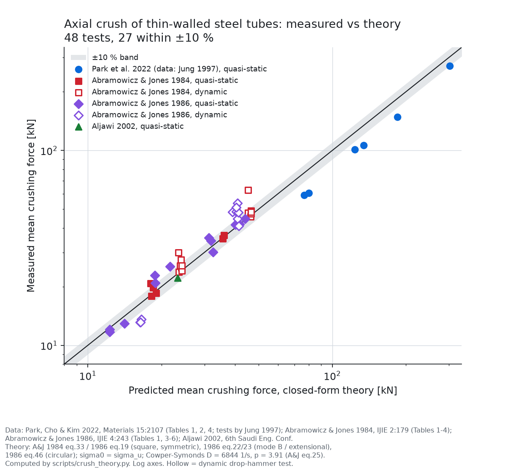
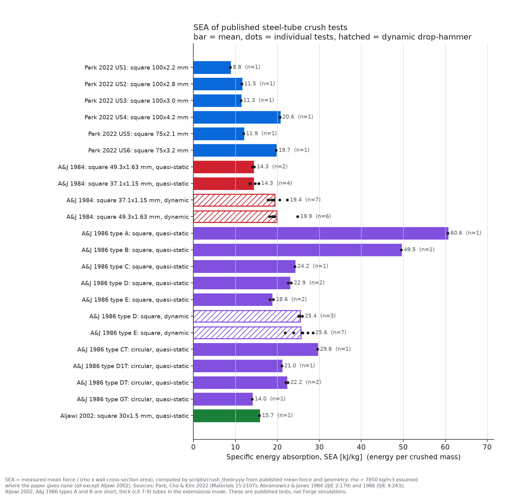
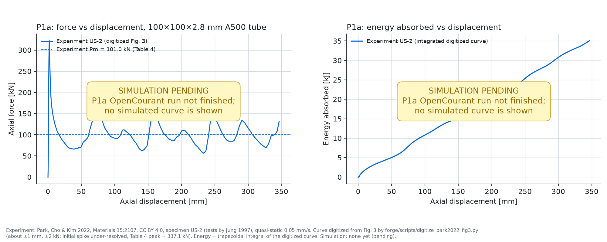

<!-- SPDX-License-Identifier: MIT -->
<p align="center">
  <picture>
    <source media="(prefers-color-scheme: dark)" srcset="assets/logo/forge-banner-dark-1280x320.png">
    
  </picture>
</p>

# Forge

**Open-source AI car generation, physics first: every engineering number comes from a validated solver or a cited test, never from the AI.**

Forge is at an early stage. Nothing here generates a car yet. The first physics validation test (P1a) is in progress; see [Status](#status).

## What Forge is for
The goal is one prompt in, one car out. From a single text prompt, Forge produces:
- a specification,
- geometry,
- solver runs (crash, stiffness, aerodynamics),
- an honest report of what was and was not validated,
- a drivable game model.

The order of work is fixed: first prove the physics chain against real tests, then generate.

## Two physics layers, never mixed
| | Truth layer | Play layer |
|---|---|---|
| Purpose | Engineering answers (crash, stiffness, aero) | A drivable car in a game |
| Physics | External validated solvers plus real test data | Real-time rigid-body physics (approximate by nature) |
| Every number carries | Source, solver version, mesh and error against a real test, or the label "unvalidated estimate" | Nothing is claimed |
| Data flow | Feeds mass, inertia, stiffness and Cd/Cl to the play layer | Its outputs are never shown as crash or aero results |

## Physics approach
- **Crash (explicit FE):** [OpenCourant](https://github.com/OpenCourant/OpenCourant) is the community continuation of OpenRadioss (AGPL-3.0). It runs **unmodified, as a separate program**: Forge writes the input deck, launches the solver and parses its output. We do not link it, patch it or vendor it. The fork is young (first stable build 2026-10-11), so we pin a build and validate it ourselves.
- **Stiffness and modal (implicit FE):** MFEM (BSD-3) as the clean default; CalculiX (GPL-2.0) as a ready-made solver, server-side only.
- **Geometry and meshing:** Open CASCADE (OCCT) for CAD, and Gmsh (GPL, server-side) or Netgen/fTetWild for meshing.
- **Vehicle dynamics checks:** Project Chrono (BSD-3).
- **Validation metric:** curve correlation against measured signals (ISO/TS 18571), with peak and mean values reported alongside.

Licence research behind these choices: [research/licences.md](research/licences.md).

## Validation
### Published axial-crush tests (the P1a reference set)
We collected 48 published axial-crush tests on thin-walled steel tubes. Each value was read from a table or the text of the paper. We then checked every test against the classic closed-form theory:
- Wierzbicki & Abramowicz 1983,
- Abramowicz & Jones 1984 and 1986, with the Cowper–Symonds strain-rate correction for drop-hammer tests.

| Source | Tests | Loading | Theory error, mean (mean abs) |
|---|---|---|---|
| [Park, Cho & Kim 2022](https://doi.org/10.3390/ma15062107), *Materials* 15:2107 (tests by Jung 1997), A500 steel, 75–100 mm square | 6 | quasi-static, 0.05 mm/s | +24.5 % (24.5 %) |
| [Abramowicz & Jones 1984](https://doi.org/10.1016/0734-743X(84)90005-8), *IJIE* 2:179, mild steel, 37 and 49 mm square | 6 + 13 | static + drop hammer, 6–10 m/s | −2.5 % (4.5 %) static; −7.2 % (7.5 %) dynamic |
| [Abramowicz & Jones 1986](https://doi.org/10.1016/0734-743X(86)90017-5), *IJIE* 4:243, steel, square and circular | 12 + 10 | static + drop hammer, 4.6–11 m/s | −3.5 % (7.5 %) static; −3.1 % (17.5 %) dynamic |
| [Aljawi 2002](https://faculty.kfupm.edu.sa/COE/sadiq/proceedings/SEC2002/vol3/P003.pdf), 6th Saudi Eng. Conf., mild steel, 30 mm square | 1 | quasi-static | +5.2 % |

Error is (theory − measured) / measured. Overall, 27 of the 48 tests fall within ±10 %. Without the strain-rate correction, the dynamic tests are under-predicted by about 28 %. The theory over-predicts the Park/Jung A500 tubes by 10–32 %; we have not yet established why. All citations, formulas, assumptions (σ₀ = σ_u, ρ = 7850 kg/m³ where unreported) and caveats are in [research/crush-experiments.md](research/crush-experiments.md). The data is in [data/crush-experiments.csv](data/crush-experiments.csv), and the theory check is reproduced by [scripts/crush_theory.py](scripts/crush_theory.py).

<p align="center"></p>

*Measured vs closed-form mean crushing force with a ±10 % band. Data: Park et al. 2022; Abramowicz & Jones 1984, 1986; Aljawi 2002. Theory: A&J 1984 eq. 33 / 1986 eq. 19, 22, 23, 46, with Cowper–Symonds D = 6844 s⁻¹, p = 3.91.*

<p align="center"></p>

*Specific energy absorption (energy per crushed mass), computed from the published mean force and geometry. Same sources as above.*

### Status
- **P1a: in progress, no result yet.** P1a is a square steel tube (Park 2022 specimen US-2: 100 × 100 × 2.8 mm, 450 mm long, ASTM A500 Grade A) crushed in OpenCourant and compared with the measured curve. The targets are peak force 337.1 kN and mean force 101.0 kN (Park 2022, Table 4). The panel below shows the experiment only. The simulated curve will be added when the run finishes and its report ([forge/docs/physics/p1a-tube-crush.md](forge/docs/physics/p1a-tube-crush.md)) exists.
- **P1b:** not started.

<p align="center"></p>

*Experiment: Park et al. 2022 (CC BY 4.0), US-2, digitized from Fig. 3 (±1 mm, ±2 kN). Simulation: pending.*

## Materials data policy
- Every material parameter carries its source (DOI or dataset), licence, reference strain rate and temperature, and a validation error where one exists.
- **Allowed sources:**
  - NIST open datasets,
  - CC BY papers,
  - MatCalc open CALPHAD databases (ODbL),
  - Materials Project core data (CC BY),
  - pycalphad/ESPEI (MIT),
  - our own fits to open raw data.
- **Never ingested** into the product, any index or any training data: MatWeb, NIMS MatNavi, Thermo-Calc databases, Granta, MMPDS or NIST SRD.
- Paywalled papers are cited, and their numbers re-derived or quoted, never copied wholesale.

Details: [research/materials.md](research/materials.md).

## Stack
| Part | Choice | State |
|---|---|---|
| Core and orchestration | Rust (deck generation, solver launch, result parsing, validation metrics) | `forge/crates/forge-crash`, in progress |
| Compute | CPU by default. NVIDIA CUDA, locally or on a rented RunPod A100, as an optional speed-up behind a `Compute` trait. Solvers always run as external programs | CPU backend only |
| Game (play layer) | Bevy + Rapier | planned |
| AI planning | OpenRouter, through a single client with a hard monthly spend cap (refuses calls past the cap) and per-call cost logging. The AI plans, writes inputs and explains results; **it never produces physics numbers** | planned |

## Roadmap
1. **P1a** tube axial crush in OpenCourant vs Park 2022 US-2 *(in progress)*
2. **P1b** NHTSA 56 km/h full-frontal rigid-barrier test with the public CCSA Toyota Yaris model, scored against barrier force and B-pillar acceleration
3. Frame: parametric chassis, torsional and bending stiffness by FE
4. Body panels with stamping and moulding constraints
5. Aero: CFD validated on DrivAerML and AhmedML (CC BY-SA 4.0) before any generated car
6. Assembly with snap-fits and adhesive bonds; joint strength by FE
7. Drivable game fed by truth-layer data
8. One-prompt pipeline: prompt → spec → geometry → solvers → report → drivable car

Forge makes no claims about generated cars until P1b passes.

## Repository layout
```
forge/                   Rust workspace (truth-layer crash orchestration) and its docs and figures
data/                    curated small datasets (published test values)
research/                licence, materials and crush-test research
scripts/                 theory check, plots and logo generation (Python)
assets/logo/             Forge and cargen logos (SVG and PNG)
PLAN.md, LOG.md          plan and dated work log (Europe/Zagreb)
```
Large solver output, `target/`, third-party solver binaries and copyrighted paper extracts are not tracked (see `.gitignore`).

To regenerate the figures: `python3 scripts/crush_theory.py && python3 scripts/crush_plots.py` (needs matplotlib and numpy).

## License
Forge's own code, docs and figures are released under the [MIT License](LICENSE), © 2026 galion-studio. The logos are original artwork under the same licence.

Third-party software and data keep their own licences. None of it is vendored in this repository.
| Component | Licence | How Forge uses it |
|---|---|---|
| OpenCourant (ex-OpenRadioss) | AGPL-3.0 | Unmodified separate program; any patch we make will be published |
| CalculiX, Gmsh | GPL-2.0 / GPL-2.0-or-later | Separate programs, server-side only |
| MFEM, Project Chrono | BSD-3-Clause | Libraries or programs |
| Open CASCADE | LGPL-2.1 with OCCT exception | Dynamic library |
| Bevy / Rapier | MIT or Apache-2.0 / Apache-2.0 | Game layer |
| Park et al. 2022 | CC BY 4.0 | Test values and digitized curve, with attribution |
| Abramowicz & Jones 1984, 1986; Aljawi 2002 | Publisher copyright | Numerical values cited as facts; no text or figures reproduced |
| DrivAerML / AhmedML | CC BY-SA 4.0 | Planned aero validation |
| NHTSA crash data, CCSA FE models | US Government / public domain (to be re-verified on the primary pages) | Planned P1b |

This licence summary is engineering research, not legal advice.
